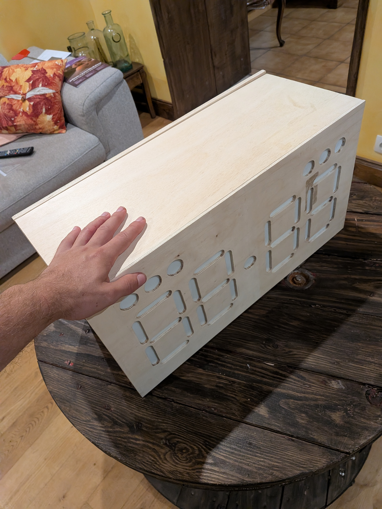
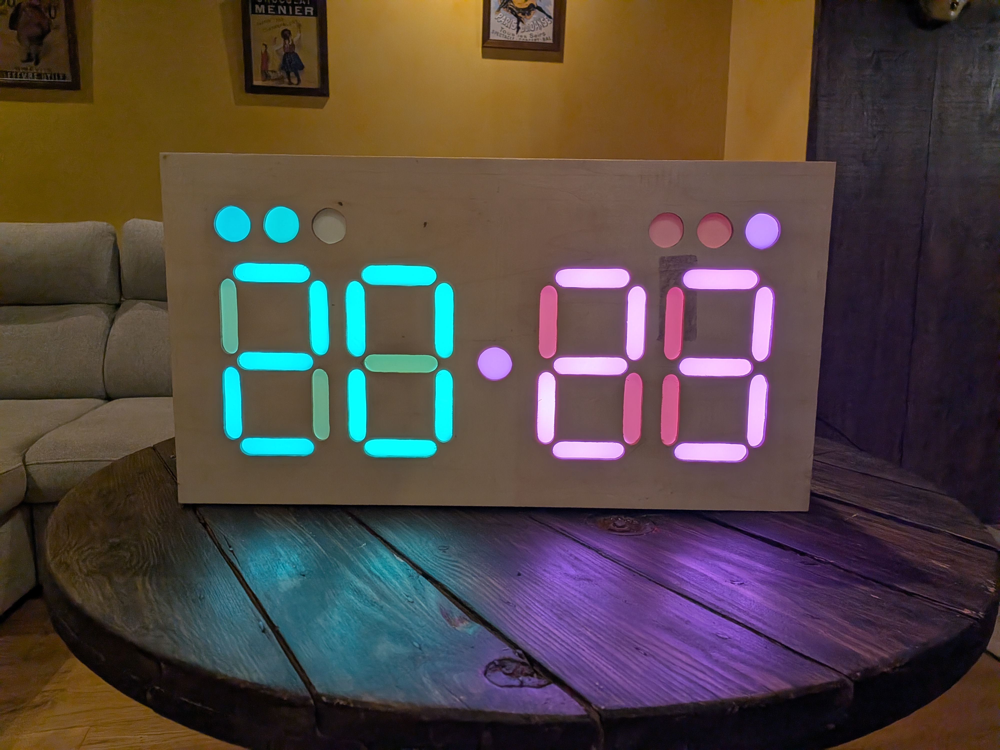
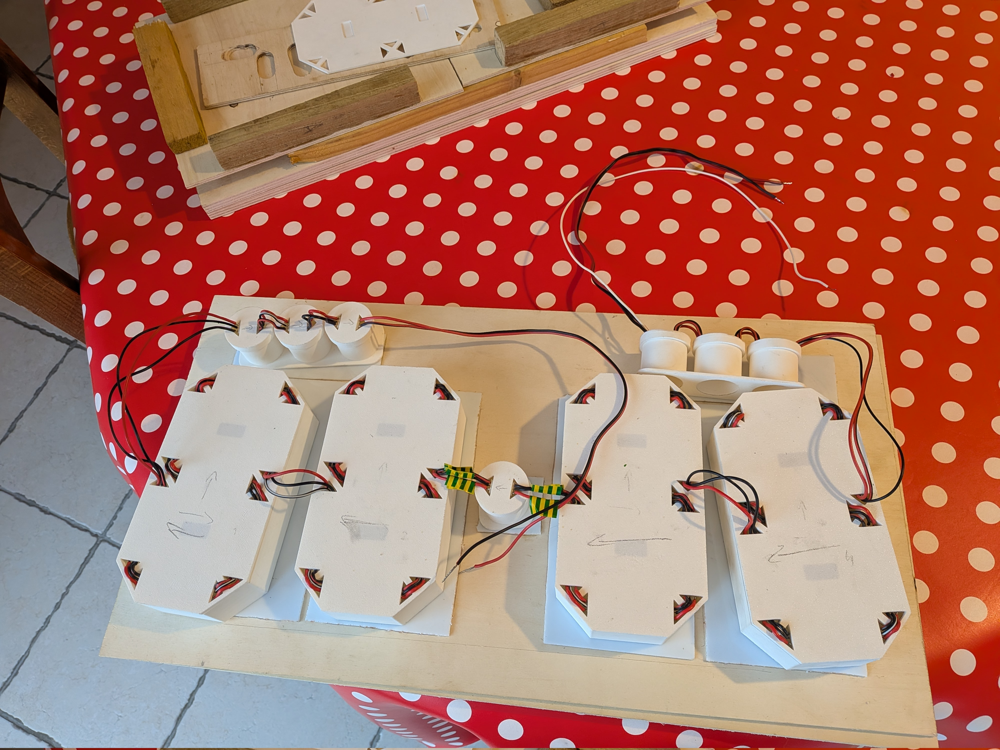

# Volleyball score displayer

## The project

### The rules

Welcome to the repertory of one volleyball passionate guy's personal project!  
One simple idea :

***Learn and practice by doing!***

As the goal is to **improve** and to **understand**, I have set this restriction:

***No AI allowed during all the process.***  
(Yes, even for this README o.O)

### Skill set

This project aims to improve my engineering skills, to be able to define, create, build, test and debug complete and concrete projects. This uses several skills, like:

- Specifications
- Code architecture & development
- Electronic design
- Soldering
- PCB layout
- 3D model and printing
- Laser cutting machine
- Assembling and building

# Advancement

## Part 1: the prototype

Today, the first prototype is finished. This is a good base for the next iteration.

### How it is done

Here is a quick summary of used technologies for this first prototype.

| Solution | Why |
|---|---|
| Arduino Uno & C++ | simple, well know, already have one |
| ws2812b LEDs   | commonly used, library available, serial command |
| Opal plexiglass for LED diffuser | robust, uniform |
| 3D printed LEDs holders | modular |
| Wooden box |  I like wooden stuff |

### Result

Finally, the key improvements for the next generation are:
- Better plexiglass separation
- Better light sealing
- More ergonomic box
- Easier personalization

## Part 2: coming next... stay tuned!

1st step = needs & specifications